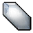

# 标签速查表

本文件由 `scripts/build-tag-reference.mjs` 依据 `content/tags.yaml`、
`content/monsters/` 与 `public/img/common/` 生成，用于查阅各属性可填写的值。

「示例」列可直接复制到卡片 HTML 中。修改标签体系后执行 `pnpm reference` 重新生成，
不要手工编辑本文件。

## 属性总览

| 属性 | 所属元素 | 类型 | 取值个数 | 示例 |
| --- | --- | --- | --- | --- |
| `data-id` | article | 字符串 | — | `data-id="BST101"` |
| `data-name` | article | 字符串 | — | `data-name="拉塔托斯克"` |
| `data-race` | article | 枚举 | 4 | `data-race="beast"` |
| `data-level` | article | 枚举 | 9 | `data-level="1"` |
| `data-part` | li.part | 枚举 | 4 | `data-part="basic"` |
| `data-act` | li.part | 枚举 | 3 | `data-act="main"` |
| `data-bonus` | li.part | 枚举 | 11 | `data-bonus="str"` |
| `data-dmg` | li.part | 枚举 | 11 | `data-dmg="phy4"` |
| `data-mult` | li.part | 枚举 | 6 | `data-mult="str"` |
| `data-dcbonus` | li.part | 枚举 | 6 | `data-dcbonus="str"` |
| `data-attack` | li.part | 枚举 | 4 | `data-attack="melee"` |
| `data-check` | li.part | 枚举 | 2 | `data-check="hit save"` |
| `data-hit` | li.part | 枚举（六项属性） | 6 | `data-hit="dex"` |
| `data-save` | li.part | 字符串 `属性:DC` | — | `data-save="wis:12"` |
| `data-str` | article | 整数 | 23 | `data-str="14"` |
| `data-dex` | article | 整数 | 20 | `data-dex="15"` |
| `data-con` | article | 整数 | 21 | `data-con="16"` |
| `data-int` | article | 整数 | 24 | `data-int="14"` |
| `data-wis` | article | 整数 | 24 | `data-wis="15"` |
| `data-cha` | article | 整数 | 26 | `data-cha="15"` |
| `data-dom` | article | 整数 | 9 | `data-dom="6"` |
| `data-hp` | article | 整数 | 58 | `data-hp="62"` |
| `data-ac` | article | 整数 | 2 | `data-ac="8"` |

## 枚举属性

取值区分大小写。标为可多选的属性以单个空格分隔多个值，例如 `data-dmg="phy4 ele1"`。

### `data-race` — 种族

魔物种族，单选。写在 `<article class="monster">` 上。

| 取值 | 含义 | 示例 | 图标 |
| --- | --- | --- | --- |
| `beast` | 野兽 | `data-race="beast"` |  |
| `elf` | 精灵 | `data-race="elf"` |  |
| `undead` | 亡灵 | `data-race="undead"` |  |
| `none` | 无魔物 | `data-race="none"` | — |

### `data-level` — 等级

魔物等级，单选。写在 `<article class="monster">` 上。

| 取值 | 含义 | 示例 | 图标 |
| --- | --- | --- | --- |
| `1` | 1 | `data-level="1"` | — |
| `2` | 2 | `data-level="2"` | — |
| `3` | 3 | `data-level="3"` | — |
| `4` | 4 | `data-level="4"` | — |
| `5` | 5 | `data-level="5"` | — |
| `6` | 6 | `data-level="6"` | — |
| `7` | 7 | `data-level="7"` | — |
| `8` | 8 | `data-level="8"` | — |
| `9` | 9 | `data-level="9"` | — |

### `data-part` — 部件

部件类型，单选。写在 `<li class="part">` 上。

| 取值 | 含义 | 示例 | 图标 |
| --- | --- | --- | --- |
| `basic` | 基础攻击 | `data-part="basic"` | — |
| `m` | M | `data-part="m"` |  |
| `s1` | S1 | `data-part="s1"` |  |
| `s2` | S2 | `data-part="s2"` |  |

### `data-act` — 动作

部件动作类型，单选。写在 `<li class="part">` 上。

| 取值 | 含义 | 示例 | 图标 |
| --- | --- | --- | --- |
| `main` | 主要 | `data-act="main"` |  |
| `react` | 反应 | `data-act="react"` |  |
| `passive` | 总是生效 | `data-act="passive"` | — |

### `data-bonus` — 加成

部件提供的属性加成，可多选。写在 `<li class="part">` 上。

| 取值 | 含义 | 示例 | 图标 |
| --- | --- | --- | --- |
| `str` | 力量 | `data-bonus="str"` |  |
| `dex` | 敏捷 | `data-bonus="dex"` |  |
| `con` | 体质 | `data-bonus="con"` |  |
| `int` | 智力 | `data-bonus="int"` |  |
| `wis` | 感知 | `data-bonus="wis"` |  |
| `cha` | 魅力 | `data-bonus="cha"` |  |
| `mhp` | 最大生命值 | `data-bonus="mhp"` |  |
| `ac` | 护甲 | `data-bonus="ac"` |  |
| `ini` | 先攻 | `data-bonus="ini"` |  |
| `hit` | 命中 | `data-bonus="hit"` |  |
| `dc` | 豁免DC | `data-bonus="dc"` |  |

### `data-dmg` — 伤害类型

部件造成的伤害类型，可多选。写在 `<li class="part">` 上。

| 取值 | 含义 | 示例 | 图标 |
| --- | --- | --- | --- |
| `phy4` | 物理 | `data-dmg="phy4"` |  |
| `ele1` | 火焰 | `data-dmg="ele1"` |  |
| `ele2` | 寒冷 | `data-dmg="ele2"` |  |
| `ele3` | 闪电 | `data-dmg="ele3"` |  |
| `ele7` | 自然 | `data-dmg="ele7"` |  |
| `mag1` | 光耀 | `data-dmg="mag1"` |  |
| `mag2` | 死灵 | `data-dmg="mag2"` |  |
| `mag3` | 力场 | `data-dmg="mag3"` |  |
| `mag4` | 心灵 | `data-dmg="mag4"` |  |
| `heal` | 治疗 | `data-dmg="heal"` |  |
| `shield` | 临时生命值 | `data-dmg="shield"` |  |

### `data-mult` — 伤害加值

伤害数值的加值来源属性，可多选。写在 `<li class="part">` 上。

| 取值 | 含义 | 示例 | 图标 |
| --- | --- | --- | --- |
| `str` | 力量 | `data-mult="str"` |  |
| `dex` | 敏捷 | `data-mult="dex"` |  |
| `con` | 体质 | `data-mult="con"` |  |
| `int` | 智力 | `data-mult="int"` |  |
| `wis` | 感知 | `data-mult="wis"` |  |
| `cha` | 魅力 | `data-mult="cha"` |  |

### `data-dcbonus` — DC加值

豁免 DC 的加值来源属性，可多选。写在 `<li class="part">` 上。

| 取值 | 含义 | 示例 | 图标 |
| --- | --- | --- | --- |
| `str` | 力量 | `data-dcbonus="str"` |  |
| `dex` | 敏捷 | `data-dcbonus="dex"` |  |
| `con` | 体质 | `data-dcbonus="con"` |  |
| `int` | 智力 | `data-dcbonus="int"` |  |
| `wis` | 感知 | `data-dcbonus="wis"` |  |
| `cha` | 魅力 | `data-dcbonus="cha"` |  |

### `data-attack` — 攻击类型

攻击类型，可多选。写在 `<li class="part">` 上。

| 取值 | 含义 | 示例 | 图标 |
| --- | --- | --- | --- |
| `melee` | 近战 | `data-attack="melee"` |  |
| `ranged` | 远程 | `data-attack="ranged"` |  |
| `spell` | 法术 | `data-attack="spell"` |  |
| `aoe` | 范围 | `data-attack="aoe"` |  |

### `data-check` — 检定

该部件是否需要命中或豁免检定，可多选。写在 `<li class="part">` 上。

| 取值 | 含义 | 示例 | 图标 |
| --- | --- | --- | --- |
| `hit` | 需要命中 | `data-check="hit"` |  |
| `save` | 需要豁免 | `data-check="save"` |  |

### `data-hit` — 命中检定属性

写在 `<li class="part">` 上，仅当 `data-check` 含 `hit` 时生效。

| 取值 | 含义 | 示例 | 图标 |
| --- | --- | --- | --- |
| `str` | 力量 | `data-hit="str"` |  |
| `dex` | 敏捷 | `data-hit="dex"` |  |
| `con` | 体质 | `data-hit="con"` |  |
| `int` | 智力 | `data-hit="int"` |  |
| `wis` | 感知 | `data-hit="wis"` |  |
| `cha` | 魅力 | `data-hit="cha"` |  |

### `data-save` — 豁免检定

写在 `<li class="part">` 上，仅当 `data-check` 含 `save` 时生效。
格式为 `<属性缩写>:<DC>`，属性缩写与上表一致。

| 示例 | 含义 |
| --- | --- |
| `data-save="wis:12"` | 感知豁免，DC 12 |
| `data-save="con:14"` | 体质豁免，DC 14 |

## 数值属性

下表列出各数值属性在当前魔物中的实测取值范围。
全部为整数，构建不做上下限校验，新增魔物时可超出下表范围。

| 属性 | 含义 | 最小值 | 最大值 | 现有取值 | 示例 |
| --- | --- | --- | --- | --- | --- |
| `data-str` | 力量 | 0 | 40 | 0–40（23 种） | `data-str="14"` |
| `data-dex` | 敏捷 | 0 | 36 | 0–36（20 种） | `data-dex="15"` |
| `data-con` | 体质 | 0 | 38 | 0–38（21 种） | `data-con="16"` |
| `data-int` | 智力 | 0 | 38 | 0–38（24 种） | `data-int="14"` |
| `data-wis` | 感知 | 0 | 40 | 0–40（24 种） | `data-wis="15"` |
| `data-cha` | 魅力 | 0 | 40 | 0–40（26 种） | `data-cha="15"` |
| `data-dom` | 支配力 | 1 | 32 | 1、2、3、4、6、9、12、16、32 | `data-dom="6"` |
| `data-hp` | 最大生命值 | 0 | 275 | 0–275（58 种） | `data-hp="62"` |
| `data-ac` | 护甲等级 | 0 | 8 | 0、8 | `data-ac="8"` |

## 图标清单

「标签」列可直接粘贴到卡片的描述文字中。图标位于 `public/img/common/`，
引用时使用 `img/common/` 开头的相对路径。

### 六项属性

| 文件 | 内容 | 预览 | 可复制标签 |
| --- | --- | --- | --- |
| `STR.webp` | 力量 |  | `` |
| `DEX.webp` | 敏捷 |  | `` |
| `CON.webp` | 体质 |  | `` |
| `INT.webp` | 智力 |  | `` |
| `WIS.webp` | 感知 |  | `` |
| `CHA.webp` | 魅力 |  | `` |

### 其他数值

| 文件 | 内容 | 预览 | 可复制标签 |
| --- | --- | --- | --- |
| `MHP.webp` | 最大生命值 |  | `` |
| `AC.webp` | 护甲 |  | `` |
| `INI.webp` | 先攻 |  | `` |

### 检定

| 文件 | 内容 | 预览 | 可复制标签 |
| --- | --- | --- | --- |
| `attack.webp` | 命中检定 |  | `` |
| `save.webp` | 豁免检定 |  | `` |

### 伤害类型

| 文件 | 内容 | 预览 | 可复制标签 |
| --- | --- | --- | --- |
| `phy4.webp` | 物理 |  | `` |
| `ele1.webp` | 火焰 |  | `` |
| `ele2.webp` | 寒冷 |  | `` |
| `ele3.webp` | 闪电 |  | `` |
| `ele7.webp` | 自然 |  | `` |
| `mag1.webp` | 光耀 |  | `` |
| `mag2.webp` | 死灵 |  | `` |
| `mag3.webp` | 力场 |  | `` |
| `mag4.webp` | 心灵 |  | `` |
| `heal.webp` | 治疗 |  | `` |
| `shield.webp` | 临时生命值 |  | `` |

### 攻击类型

| 文件 | 内容 | 预览 | 可复制标签 |
| --- | --- | --- | --- |
| `melee.webp` | 近战 |  | `` |
| `ranged.webp` | 远程 |  | `` |
| `spell.webp` | 法术 |  | `` |
| `AoE.webp` | 范围 |  | `` |

### 动作

| 文件 | 内容 | 预览 | 可复制标签 |
| --- | --- | --- | --- |
| `main.webp` | 主要动作 |  | `` |
| `reactive.webp` | 反应动作 |  | `` |

### 种族

| 文件 | 内容 | 预览 | 可复制标签 |
| --- | --- | --- | --- |
| `beast.webp` | 野兽 |  | `` |
| `elf.webp` | 精灵 |  | `` |
| `undead.webp` | 亡灵 |  | `` |

### 部件边框

| 文件 | 内容 | 预览 | 可复制标签 |
| --- | --- | --- | --- |
| `b.webp` | 基础攻击边框 |  | `` |
| `m.webp` | M 边框 |  | `` |
| `s1.webp` | S1 边框 |  | `` |
| `s2.webp` | S2 边框 |  | `` |

### 部件角标

| 文件 | 内容 | 预览 | 可复制标签 |
| --- | --- | --- | --- |
| `bt.webp` | 基础攻击角标 |  | `` |
| `mt.webp` | M 角标 |  | `` |
| `s1t.webp` | S1 角标 |  | `` |
| `s2t.webp` | S2 角标 |  | `` |

### 其他

| 文件 | 内容 | 预览 | 可复制标签 |
| --- | --- | --- | --- |
| `dice.webp` | 伤害骰 |  | `` |
| `Dom.webp` | 支配力 |  | `` |
| `DungeonWithin.webp` | 游戏图标 |  | `` |

### 内部素材

下列文件供构建与样式使用，内容中不应引用。

| 文件 | 用途 |
| --- | --- |
| `mask-basic.png`、`mask-m.png`、`mask-s1.png`、`mask-s2.png` | 徽章头像裁切遮罩，由 `pnpm masks` 生成 |
| `b_back.webp`、`m_back.webp`、`s1_back.webp`、`s2_back.webp` | 生成上述遮罩的中间素材 |
| `heal_old.webp` | 未被内容引用的旧版治疗图标 |
